## 📘 Описание UML-диаграмм

### Roadmap
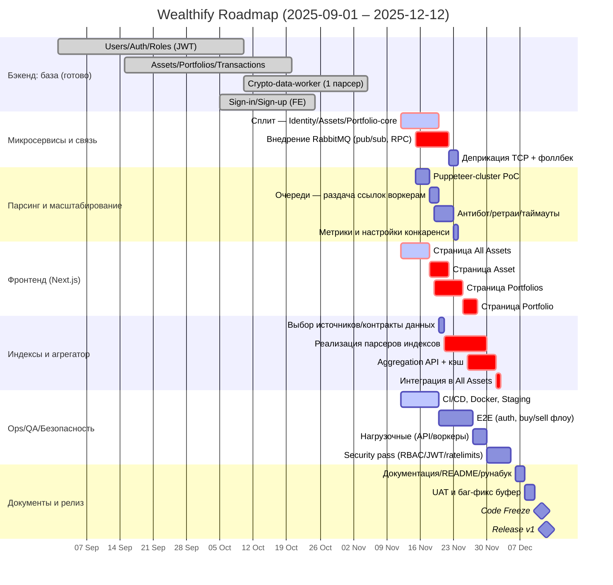

### Diagrams
Представленные UML-диаграммы описывают ключевые процессы и структуру взаимодействия компонентов системы.

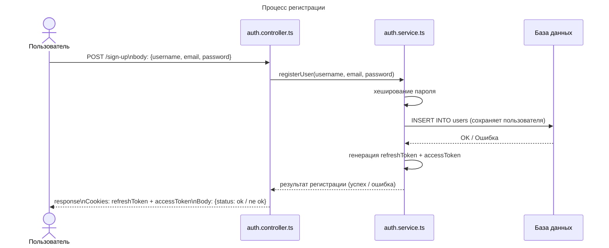
Процесс регистрации — диаграмма последовательности, демонстрирующая шаги, выполняемые при создании нового пользователя: передача данных с клиента, обращение к контроллеру и сервису, хеширование пароля, сохранение записи в базе данных и генерация токенов доступа.
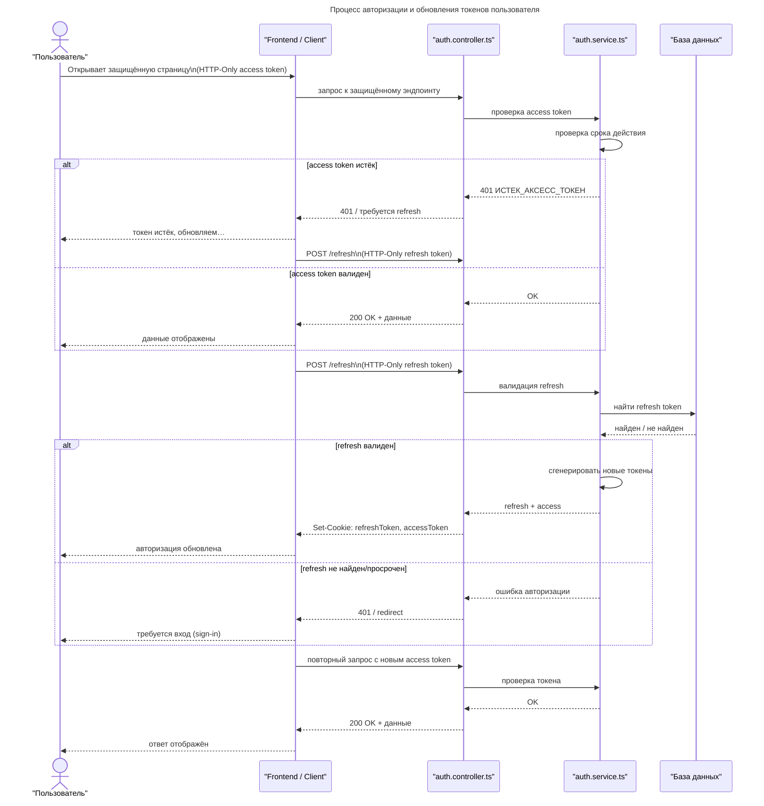
Процесс авторизации и обновления токенов — диаграмма последовательности, показывающая проверку access token при обращении к защищённым эндпоинтам, обработку ситуации с истекшим токеном, генерацию новых refresh и access токенов и повторную проверку авторизации.

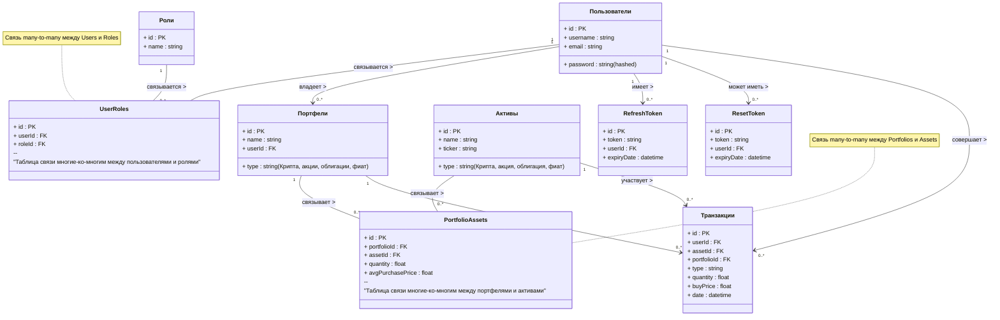
Модели и их взаимодействие (User Portfolio System) — диаграмма классов, отражающая структуру данных приложения: пользователей, роли, портфели, активы, транзакции и токены.
В ней указаны первичные и внешние ключи, а также связи между сущностями: один-ко-многим (например, пользователь → портфели) и многие-ко-многим (через таблицы UserRoles и PortfolioAssets).

*Доступные действия пользователя*

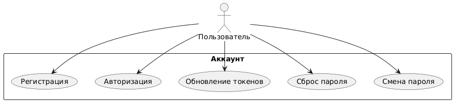
Диаграмма отображает все действия, доступные пользователю для управления аккаунтом. Эти действия включают регистрацию, авторизацию, обновление токенов, сброс пароля и изменение пароля. Часть функций доступна публично, но для большинства операций требуется авторизация через JwtAuthGuard.

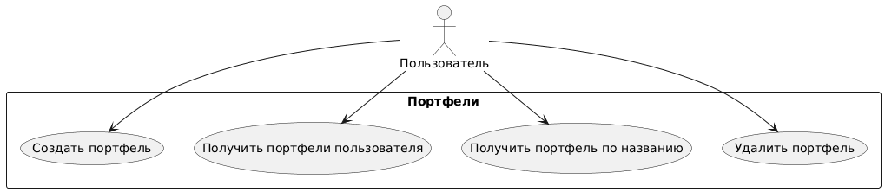
Диаграмма отображает все действия, доступные пользователю для управления аккаунтом. Эти действия включают регистрацию, авторизацию, обновление токенов, сброс пароля и изменение пароля. Часть функций доступна публично, но для большинства операций требуется авторизация через JwtAuthGuard.

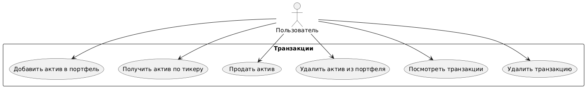

Диаграмма отображает все действия, доступные пользователю для управления аккаунтом. Эти действия включают регистрацию, авторизацию, обновление токенов, сброс пароля и изменение пароля. Часть функций доступна публично, но для большинства операций требуется авторизация через JwtAuthGuard.

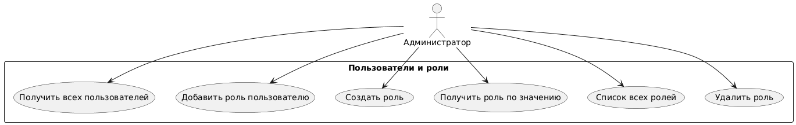

Диаграмма показывает действия, доступные администратору для управления пользователями и ролями. Администратор может получать информацию обо всех пользователях, добавлять и удалять роли, а также создавать новые роли и получать их по значению.

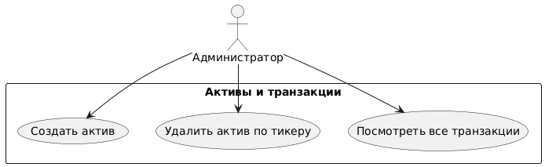

Диаграмма показывает действия, доступные администратору для работы с активами и транзакциями. Администратор может создавать активы, удалять их по тикеру, а также просматривать все транзакции. 

Все эти действия также требуют наличия роли ADMIN и проверки прав через JwtAuthGuard и RolesGuard.

```mermaid
classDiagram
  %% =========================
  %% ОСНОВНЫЕ СУЩНОСТИ (Identity)
  %% =========================
  class User {
    +id: number
    +username: string
    +email: string
    +password: string
  }

  class Role {
    +id: number
    +value: string
    +description: string
  }

  class UserRoles {
    +id: number
    +userId: number
    +roleId: number
  }

  class RefreshToken {
    +id: number
    +token: string  %% hashed
    +userId: number %% unique
    +expiryDate: Date
  }

  class ResetToken {
    +id: number
    +token: string  %% hashed
    +userId: number %% unique
    +expiryDate: Date
  }

  class FavoriteAsset {
    +id: number
    +userId: number
    +assetId: number
    +createdAt: Date
  }

  %% =========================
  %% ПОРТФЕЛИ / ТРАНЗАКЦИИ
  %% =========================
  class Portfolio {
    +id: number
    +name: string
    +type: PortfolioType
    +userId: number
  }

  class PortfolioAssets {
    +id: number
    +portfolioId: number
    +assetId: number
    +quantity: number
    +averageBuyPrice: number
    +purchaseDate: Date?
  }

  class Transaction {
    +id: number
    +portfolioId: number
    +assetId: number
    +type: TransactionType
    +quantity: number
    +pricePerUnit: number
    +date: Date
  }

  %% =========================
  %% АКТИВЫ (общая таблица assets)
  %% =========================
  class Asset {
    +id: number
    +name: string
    +ticker: string
    +type: AssetType
  }

  %% =========================
  %% КАТЕГОРИИ АКТИВОВ (выделено в сущность)
  %% =========================
  class AssetCategory {
    +id: number
    +name: string
    +source?: string
  }

  class AssetCategoryLink {
    +id: number
    +assetId: number
    +categoryId: number
  }

  %% =========================
  %% КРИПТО-ДАННЫЕ (crypto-data-worker)
  %% =========================
  class CryptoAssetData {
    +id: number
    +ticker: string
    +name: string
    +description?: string
    +slug?: string
    +logoUrl?: string
    +logoUrlLocal?: string
    +source?: string
    +rank?: number
    +currentPriceUsd?: number
    +marketCapUsd?: number
    +fdvUsd?: number
    +circulatingSupply?: number
    +totalSupply?: number
    +maxSupply: string|null
    +contractAddress?: string|null
    +volume24HUsd?: number
    +change1HUsdPct?: number
    +change24HUsdPct?: number
    +change7DUsdPct?: number
    +change14DUsdPct?: number
    +change30DUsdPct?: number
    +change1YUsdPct?: number
    +sparkline7D?: any
    +lastUpdatedAt?: Date
    +assetId: number  %% FK -> assets.id (unique)
  }

  class CryptoChartsData {
    +id: number
    +assetDataId: number  %% FK -> crypto_assets.id (unique)
    +capturedAt?: Date
    +h24Stats?: Array<[number,number]>
    +h24Volumes?: Array<[number,number]>
    +d7Stats?: Array<[number,number]>
    +d7Volumes?: Array<[number,number]>
    +d30Stats?: Array<[number,number]>
    +d30Volumes?: Array<[number,number]>
    +d90Stats?: Array<[number,number]>
    +d90Volumes?: Array<[number,number]>
    +d365Stats?: Array<[number,number]>
    +d365Volumes?: Array<[number,number]>
    +maxStats?: Array<[number,number]>
    +maxVolumes?: Array<[number,number]>
  }

  class CryptoCandle {
    +id: number
    +assetId: number %% FK -> crypto_assets.id
    +interval: CandleInterval
    +openTime: Date
    +open: string
    +high: string
    +low: string
    +close: string
    +volume?: string
    +marketCapUsd?: string
  }

  class RecentSearch {
    +id: number
    +userId: number
    +assetId: number
    +createdAt: Date
  }

  %% =========================
  %% ENUM'Ы
  %% =========================
  class AssetType {
    <<enumeration>>
    CRYPTO
    STOCK
    BOND
    FIAT
  }

  class PortfolioType {
    <<enumeration>>
    CRYPTO
    STOCK
    BOND
  }

  class TransactionType {
    <<enumeration>>
    BUY
    SELL
  }

  class CandleInterval {
    <<enumeration>>
    MIN1
    MIN5
    MIN15
    H1
    H4
    D1
    W1
    M1
  }

  %% =========================
  %% СВЯЗИ
  %% =========================

  %% Users <-> Roles (many-to-many)
  User "1" -- "0..*" UserRoles : userRoles
  Role "1" -- "0..*" UserRoles : roleUsers

  %% Tokens (1 user -> 0..1 token row, так как userId unique)
  User "1" o-- "0..1" RefreshToken : refreshToken
  User "1" o-- "0..1" ResetToken : resetToken

  %% Favorites / Recent searches
  User "1" o-- "0..*" FavoriteAsset : favorites
  Asset "1" o-- "0..*" FavoriteAsset : favoredBy

  User "1" o-- "0..*" RecentSearch : recentSearches
  Asset "1" o-- "0..*" RecentSearch : searchedAssets

  %% Portfolios
  User "1" o-- "0..*" Portfolio : portfolios
  Portfolio "1" o-- "0..*" PortfolioAssets : holdings
  Asset "1" -- "0..*" PortfolioAssets : inPortfolios

  Portfolio "1" o-- "0..*" Transaction : transactions
  Asset "1" -- "0..*" Transaction : transactionAsset

  %% Asset <-> Crypto snapshot (1:1)
  Asset "1" o-- "0..1" CryptoAssetData : cryptoSnapshot

  %% Charts and candles
  CryptoAssetData "1" o-- "0..1" CryptoChartsData : charts
  CryptoAssetData "1" o-- "0..*" CryptoCandle : candles

  %% Categories (вынесены в отдельную сущность)
  Asset "1" -- "0..*" AssetCategoryLink : categoryLinks
  AssetCategory "1" -- "0..*" AssetCategoryLink : assets
```
Диаграмма показывает структуру данных платформы аналитики портфелей: пользователей и их роли, портфели и состав портфелей (активы с количеством и средней ценой), а также историю транзакций. Типы активов/портфелей/транзакций вынесены в перечисления, чтобы явно фиксировать допустимые значения.

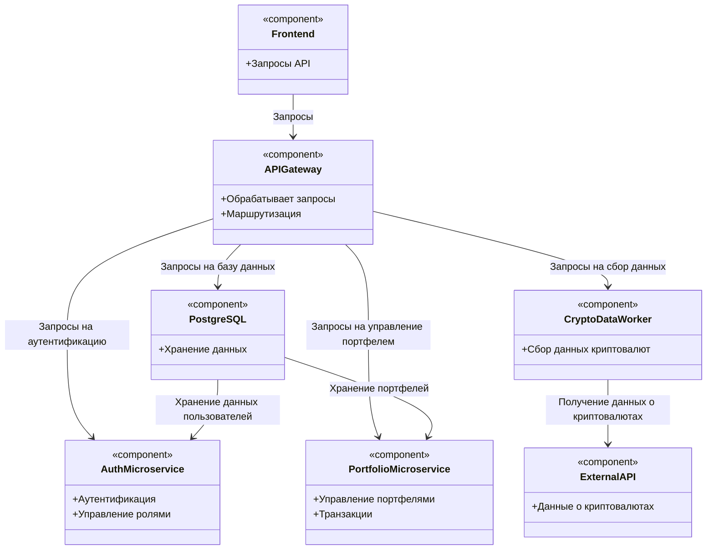
Диаграмма компонентов показывает ключевые компоненты системы "Wealthify" и их взаимодействие. Она включает компоненты фронтенда, API-шлюз, микросервисы для аутентификации, управления портфелями, сбора данных о криптовалютах и базу данных PostgreSQL. Взаимодействие между компонентами представлено через запросы API и данные, передаваемые между сервисами.

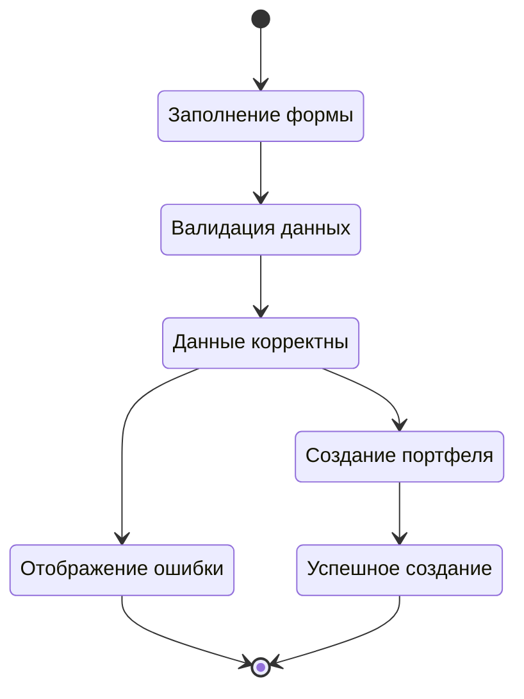
Диаграмма активности описывает процесс создания инвестиционного портфеля. Сначала пользователь заполняет форму, затем система проверяет корректность введенных данных. В случае успешной валидации создается новый портфель, а при ошибке выводится сообщение об ошибке.

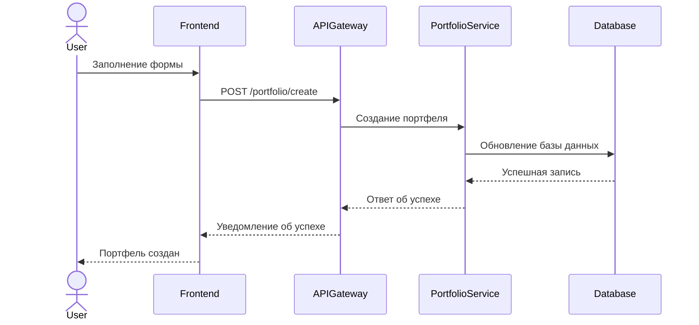
Диаграмма последовательности демонстрирует взаимодействие между пользователем, фронтендом, API-шлюзом, сервисом портфелей и базой данных при создании портфеля. Каждый этап операции отображает запросы и ответы между компонентами, включая успешное завершение операции.

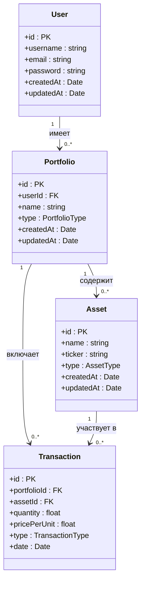
Диаграмма классов описывает основные сущности системы: пользователи, портфели, активы и транзакции. Она показывает связи между объектами, такие как отношения один ко многим между пользователем и портфелем, а также многие ко многим между активами и портфелями через транзакции.

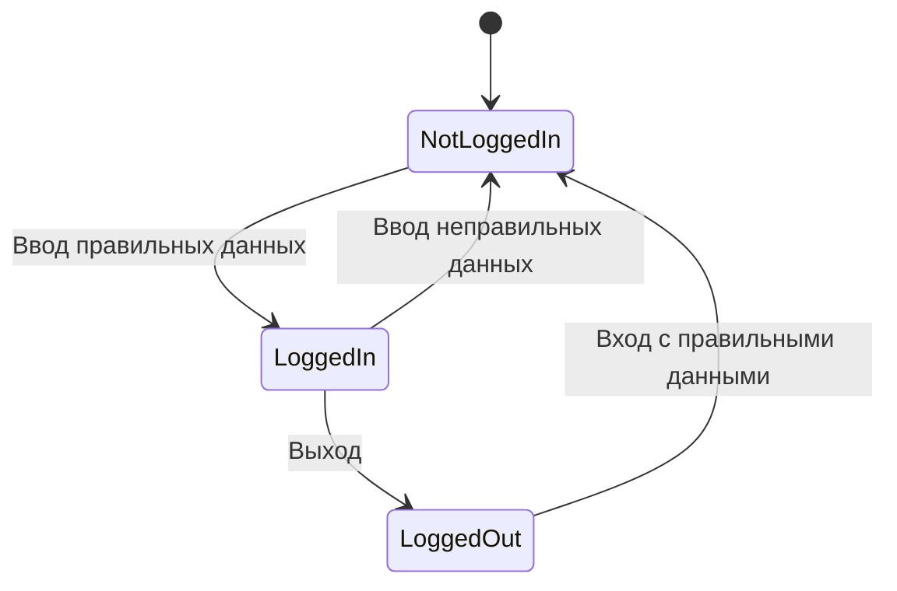

Диаграмма состояний представляет процесс авторизации пользователя в системе. Она описывает различные состояния пользователя (неавторизованный, авторизованный, вышедший) и переходы между ними, основанные на правильности введенных данных.

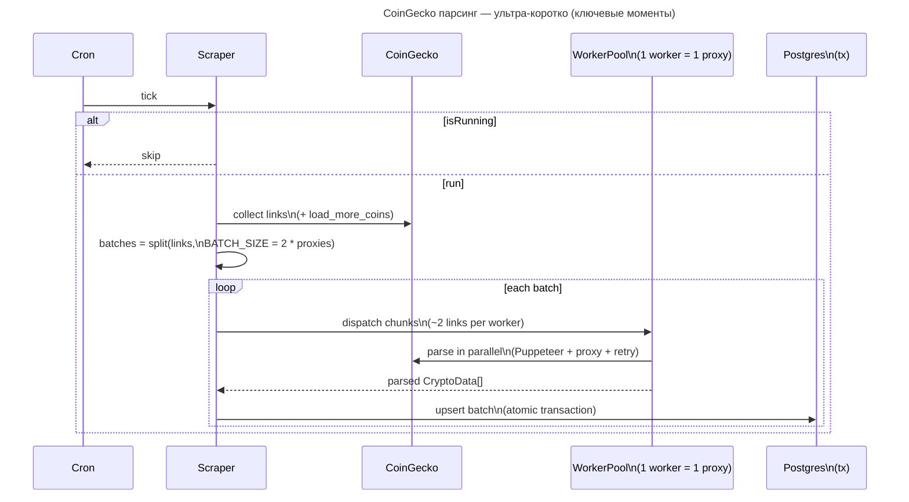
Парсинг CoinGecko — диаграмма последовательности, показывающая краткий поток работы `crypto-data-worker`: cron запускает сбор, сервис не допускает параллельных запусков через `isRunning`, затем собирает ссылки на активы (с догрузкой), режет их на батчи размера `2 * proxies`, раздаёт чанки воркерам (1 воркер = 1 proxy, ~2 ссылки на воркер), воркеры параллельно парсят страницы через Puppeteer с ретраями и возвращают `CryptoData[]`, после чего батч сохраняется в Postgres через upsert в транзакции, чтобы не было частичных обновлений данных.

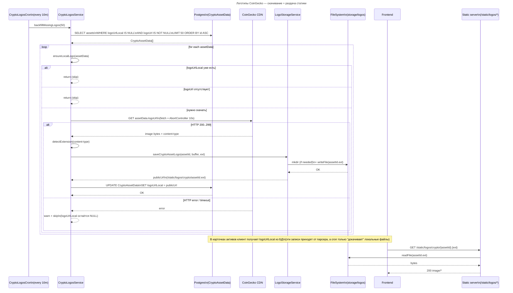
Cron раз в 10 минут выбирает из БД активы, у которых уже есть внешний logoUrl (пришёл от парсера), но ещё нет logoUrlLocal. Для каждого такого актива логотип скачивается с CoinGecko с таймаутом 10 секунд, сохраняется в файловое хранилище, а в БД записывается публичный путь /static/logos/.... Клиент затем запрашивает логотип по этому пути, и сервер отдаёт файл как статику.
